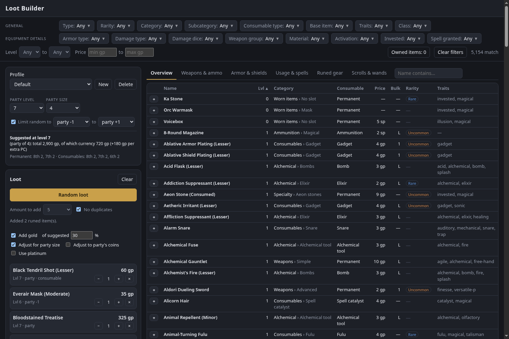

# PF2e Loot Builder

An offline loot builder for Pathfinder 2e. Open `index.html` from disk; no server needed. Item data comes from the pf2e Foundry system.



## Features

- **Browse and filter** about 5,150 items: level and price ranges, type, rarity, category, subcategory, consumable type, base item, traits, damage, armor type, activation and more. Item descriptions are the system text.
- **Random loot** that respects the filters, with an amount dropdown and a party-level window (default party level −1 to +1). Loot may exceed the treasure-by-level guidelines; the loot list shows the total against the suggestion.
- **Gold:** adds a percentage of the suggested currency for the party level, optionally scaled for party size, or adjusted to what the party already holds.
- **Scroll and wand generator** for level-appropriate spells, with spell filters.
- **Runed gear generator:** random base weapons and armor with fundamental and property runes.
- **Party awareness** through a Foundry macro: the builder leaves out items the party already owns, compares their currency to the expected amount, and checks fundamental runes against the level baseline. Missing runes are offered as upgrades on the character's own gear.
- **Profiles:** one per Foundry world (party data and saved loot lists).
- **Foundry export:** a script macro that creates a loot actor with the chosen name, items, scrolls, wands and coins.

## Use

1. Open `index.html`.
2. Set party level and size, filter, then add items or press **Random loot**.
3. For the Foundry export, press **Foundry macro**, paste it into a Script macro in Foundry and run it as GM.
4. For party data, press **Owned items**, run the shown macro in Foundry, and paste the result back.

## Rebuild the data

Requires Python 3 and the pf2e system packs in `../pf2e-system`:

```bash
python3 -I build_data.py
```

This writes `data/items.js`, the description shards in `data/desc/`, and `ORC-NOTICE.md`. Rerun it after updating pf2e-system.

## Licensing

Game data is from the pf2e system for Foundry VTT, which carries Paizo content under the ORC and OGL licenses. See `ORC-NOTICE.md`.
